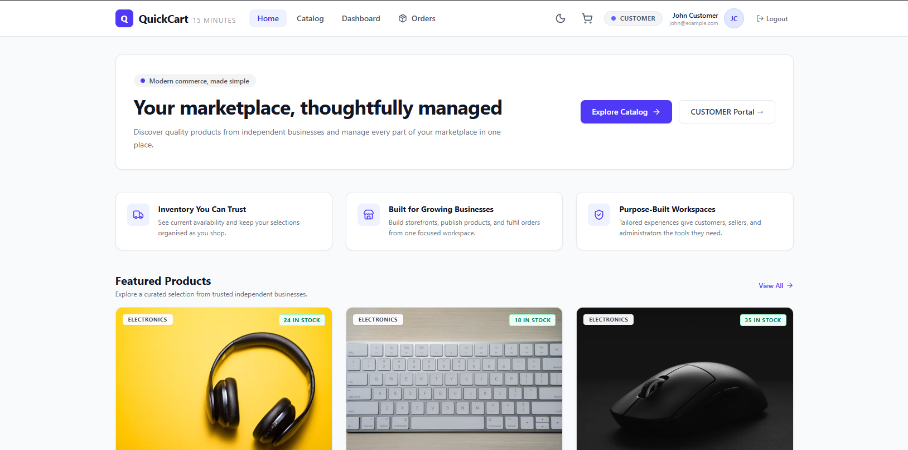

<div align="center">

</div>


# 🛒 QuickCart – Full Stack E-Commerce Application

A modern, responsive, and feature-rich **Full Stack E-Commerce Web Application** built to provide a seamless online shopping experience for customers while allowing sellers to manage their businesses, products, and orders.

QuickCart provides separate dashboards and role-based functionality for **Admin, Seller, and Customer** users, with secure authentication and RESTful API integration.

🌐 **Live Demo:** <a href="https://e-commerce-five-mu-41.vercel.app/" target="_blank" rel="noopener noreferrer">QuickCart – Live Demo</a>

---

## ✨ Features

### 🔐 Authentication & Authorization
- User registration and login
- JWT-based authentication
- Role-based access control (Admin, Seller, Customer)
- Secure API endpoints using Spring Security
- Protected frontend routes

### 🛍️ Customer Features
- Browse available products
- Search and filter products
- View product details
- Explore businesses and sellers
- Add products to cart
- Manage shopping cart
- Place and manage orders
- View order history

### 🏪 Seller Features
- Seller dashboard
- Manage multiple business
- Add and manage products
- Update product details
- Manage incoming orders
- Track business-related activities

### 👨‍💼 Admin Features
- Admin dashboard
- Manage users
- Manage sellers and businesses
- Manage products
- Monitor orders
- Access overall application information

### 🎨 UI & User Experience
- Responsive design
- Reusable React components
- Role-specific dashboards
- Modern and clean interface
- Interactive UI elements
- Smooth navigation

---

## 🛠️ Technologies Used

| Category | Technologies |
|---|---|
| Frontend | React.js, JavaScript |
| Styling | Tailwind CSS |
| Routing | React Router |
| HTTP Client | Axios |
| State Management | React Context API |
| Backend | Java, Spring Boot |
| Security | Spring Security, JWT |
| ORM | Spring Data JPA, Hibernate |
| Database | MySQL |
| API Architecture | RESTful APIs |
| Build Tools | Vite, Maven |
| Version Control | Git, GitHub |
| Deployment | Vercel, Render, Railway |

---

## 🏗️ Application Architecture

The application follows a client-server architecture.

```text
             React Frontend
                   |
                   | Axios / HTTP Requests
                   |
             Spring Boot API
                   |
          Spring Security + JWT
                   |
             DTO Layer
                   |
             Controller Layer
                   |
             Service Layer
                   |
          Repository Layer (JPA)
                   |
                MySQL
```

**Frontend:** Handles UI, routing, user interactions, and API communication.

**Backend:** Handles business logic, authentication, authorization, and data processing.

**Database:** MySQL stores users, businesses, products, carts, and order-related information.

---

## 👥 User Roles

### 👨‍💼 Admin
- Manage users and application data
- Manage businesses and sellers
- Manage products and orders
- Access admin dashboard

### 🏪 Seller
- Manage business profile
- Add, update, and manage products
- View and manage customer orders
- Access seller dashboard

### 🛍️ Customer
- Browse and search products
- Explore businesses
- Add products to cart
- Place orders
- Manage shopping activities

---

## 🚀 Getting Started

### Prerequisites

Make sure you have the following installed:

- Node.js
- npm
- Java JDK
- Maven
- MySQL
- Git

### 1. Clone the Repository

```bash
git clone https://github.com/priyanshoe/e-commerce.git
```

```bash
cd e-commerce
```

### 2. Frontend Setup

Install dependencies:

```bash
npm install
```

Create a `.env` file in the frontend root directory:

```env
VITE_API_URL=http://localhost:8080/api
```

Start the development server:

```bash
npm run dev
```

### 3. Backend Setup

   📂 **Refer backend GitHub Repository:** https://github.com/priyanshoe/e-commerce-backend
   
---

## 🔒 Security Implementation

The application implements authentication and authorization using Spring Security and JWT.

- JWT tokens for authenticated requests.
- Password-based user authentication.
- Role-based API authorization.
- Protected backend endpoints.
- Frontend route protection.
- Access restrictions based on user roles.

---

## 📌 Project Highlights

- Full-stack application using React and Spring Boot.
- RESTful API development and integration.
- JWT authentication and role-based authorization.
- Spring Security configuration.
- Database relationships using Spring Data JPA and Hibernate.
- MySQL database integration.
- Separate dashboards for Admin, Seller, and Customer.
- Reusable and maintainable React components.
- Client-server architecture.
- Git and GitHub version control.

---

## 🎯 Project Purpose

QuickCart was developed to gain practical experience in full-stack web application development and understand how frontend and backend technologies work together in a real-world application.

The project focuses on building secure REST APIs, implementing authentication and authorization, designing relational database structures, managing application data, and developing responsive user interfaces.

It demonstrates practical knowledge of **Java, Spring Boot, Spring Security, JWT, React.js, MySQL, and REST API development**.

---

## 👨‍💻 Developer

**Priyanshu Rahate**

- GitHub: https://github.com/priyanshoe
- LinkedIn: https://www.linkedin.com/in/im-priyanshu-rahate/

